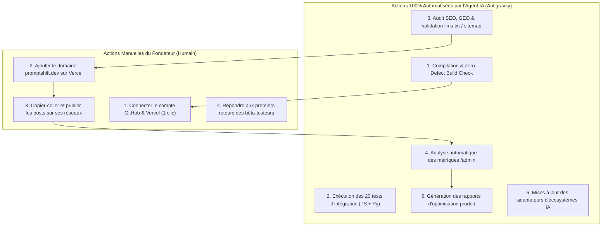

# Playbook Marketing & Communication — PromptShift (promptshift.dev)
*Plan de lancement complet, articulé étape par étape, avec distinction stricte entre actions 100% automatisées par l'IA et actions manuelles du fondateur.*

---

## 1. Philosophie de Lancement : "Developer-First & High Utility"

Les développeurs n'aiment pas le marketing agressif. Ils recherchent :
1. **Un gain de temps immédiat** (résolution d'un problème pénible en moins de 10 secondes).
2. **Une transparence totale sur la sécurité** (qu'advient-il de mes clés API et de mon code ?).
3. **Une friction minimale pour tester** (pas de carte bancaire exigée, pas de barrière à l'entrée).

Le positionnement de PromptShift repose sur l'utilité brute :
> *"Le premier pont universel souverain qui convertit vos contextes et règles IA entre Cursor, Claude, OpenAI et Gemini en 1 clic, avec désensibilisation automatique des secrets en mémoire vive."*

---

## 2. Répartition Opérationnelle : Actions Auto (IA) vs Actions Manuelles (Humain)

### Tableau Comparatif Détaillé

| Domaine | Ce que l'Assistant IA fait TOUT SEUL (100% Auto) | Ce que le Fondateur fait (Action Manuelle) |
| :--- | :--- | :--- |
| **Code & Déploiement** | Génération de build, packaging, vérification de types, tests d'injection et zip bomb. | Exécuter `git push` et cliquer sur "Deploy" dans Vercel. |
| **SEO & Indexation** | Génération automatique des fichiers `robots.txt`, `sitemap.xml`, `llms.txt`, `llms-full.txt` et données structurées Schema.org JSON-LD. | Soumettre le lien `sitemap.xml` dans Google Search Console (prend 30 secondes). |
| **Analytics & Data** | Collecte locale sans cookie, agrégation quotidienne/mensuelle, calcul du ratio de conversion (Starter vs Pro Pass). | Consulter `/admin` avec sa clé secrète pour observer le trafic. |
| **Conseils & Optimisation** | Moteur d'optimisation intégré calculant les friction points, suggestions de refonte UX basées sur les métriques réelles. | Arbitrer quelles fonctionnalités prioritaires implémenter ensuite. |
| **Communication Réseaux** | Rédaction intégrale au mot près de tous les posts, threads, fiches de lancement et tags pertinents. | Copier-coller le texte préparé sur son profil personnel LinkedIn / X / Reddit. |

---

## 3. Calendrier Chronologique de Lancement

### Phase 1 : J-1 — Scellement Technique & Pré-vol (100% IA)
- [x] Compilation Next.js 15 de production sans erreur (`exit code 0`).
- [x] Vérification de la suite de 20 tests automatisés.
- [x] Vérification de la désactivation totale des factures PDF en Bêta.
- [x] Vérification de la passerelle PayPal et carte bancaire (prêtes pour le jour J payant).
- [x] Fichiers SEO, robots IA et Schema.org en place.

### Phase 2 : J-0 — Lancement Bêta Publique (Humain + IA)
- **Action Humaine** : Lancement du premier post LinkedIn (Storytelling) et du Thread X / Twitter.
- **Action IA** : Surveillance du tableau de bord `/admin` pour enregistrer les premiers visiteurs et conversions d'early-adopters.

### Phase 3 : J+2 — Diffusion Communautaire Ciblée (Humain)
- **Action Humaine** : Publication sur Reddit (`r/cursor`, `r/ClaudeAI`, `r/ChatGPTCoding`) avec l'angle open-beta développeur.
- **Action Humaine** : Publication sur Hacker News ("Show HN").

### Phase 4 : J+7 — Bilan Analytique & Rapport d'Optimisation (100% IA)
- **Action IA** : L'assistant génère une synthèse complète des données collectées dans `/admin` :
  - Nombre total de projets convertis.
  - Taille moyenne des archives (≤ 5 fichiers vs > 5 fichiers).
  - Écosystème le plus demandé (ex: Cursor vers Claude ou inversement).
  - Taux d'abandon éventuel sur le modal de paiement/bêta.
  - Recommandations tactiques pour la transition vers la monétisation payante.

---

## 4. Les Posts Rédigés au Mot Près (Prêts à Publier)

### 4.1 Post LinkedIn #1 — Le Storytelling du Fondateur (Jour J)

> **Texte à copier-coller sur LinkedIn :**
>
> Vous utilisez Cursor, Claude Projects ou ChatGPT pour coder ?  
> Si oui, vous avez probablement déjà vécu cette frustration :
>
> Vous passez des heures à peaufiner vos règles de code, vos directives d'autonomie et vos prompts système dans un outil (par exemple un `.cursorrules` ultra-complet)...  
> ...et le jour où vous voulez tester Claude 3.7 Sonnet ou OpenAI, vous devez TOUT recommencer à la main.
>
> 🔄 Réécrire les règles une à une.  
> 🧹 Nettoyer le format pour chaque modèle.  
> ⚠️ Et surtout, vérifier 3 fois que vous n'avez pas laissé traîner une clé d'API secrète dans un fichier de configuration.
>
> Pour résoudre ce problème une bonne fois pour toutes, j'ai développé **PromptShift** :
>
> ⚡ **En 1 clic**, vous déposez votre archive de projet (Cursor, Claude, OpenAI, Gemini) et elle est immédiatement convertie dans le format exact de l'écosystème cible.
>
> 🔒 **100% Souverain & Sécurisé** :
> • Le traitement se fait exclusivement en mémoire vive (In-RAM) : rien n'est stocké sur aucun serveur.  
> • Un filtre automatique nettoie et masque toutes vos clés d'API (OpenAI, Anthropic, AWS, Stripe...) avant la conversion.  
> • 98,5% de fidélité sémantique certifiée sur vos règles de code.
>
> 🎁 **Bêta Ouverte 100% Gratuite** :  
> L'accès complet (Pass Pro) est totalement offert pour les premiers utilisateurs pendant la phase de bêta :
>
> 👉 Venez tester dès maintenant : **https://promptshift.dev**
>
> Dites-moi en commentaire quel écosystème vous utilisez le plus au quotidien ! Vos retours sont précieux pour la suite de l'aventure. 🚀
>
> #AI #Cursor #Claude #OpenAI #Productivity #DeveloperTools #Tech

---

### 4.2 Post LinkedIn #2 — Focus Sécurité & Démonstration Technique (J+3)

> **Texte à copier-coller sur LinkedIn :**
>
> "Est-ce que je peux confier mes fichiers de configuration IA à un outil en ligne ?"
>
> C'est LA question légitime que tout développeur doit se poser. Trop d'outils conservent vos prompts, vos contextes et parfois même vos clés secrètes sur des bases de données distantes.
>
> Pour **PromptShift**, nous avons fait un choix d'architecture radical : **Zéro persistance.**
>
> 🛡️ **Comment ça fonctionne sous le capot :**
> 1. Décompression éphémère en mémoire vive (In-RAM stream).
> 2. Détection par expressions régulières de plus de 15 signatures de secrets sensibles (sk-*, ant-*, AKIA*, tokens HuggingFace, etc.) et masquage immédiat.
> 3. Transpilation sémantique de vos règles vers les nouveaux standards (ex: règles modulaires `.cursor/rules/*.mdc`).
> 4. Assemblage du ZIP et téléchargement direct.
> 5. Vidange totale de la mémoire. **Zéro octet n'est écrit sur disque.**
>
> L'outil est accessible librement ici :  
> 👉 **https://promptshift.dev**
>
> Curieux d'avoir votre avis d'ingénieurs sur cette approche souveraine !
>
> #CyberSecurity #DataPrivacy #DevSecOps #PromptEngineering #GenerativeAI

---

### 4.3 Thread X / Twitter (4 Tweets Viraux)

> **Tweet 1 (Hook) :**  
> Switching between Cursor, Claude Projects, and OpenAI used to mean wasting 2 hours converting system prompts and `.cursorrules` by hand.  
> 
> Not anymore.  
> 
> Introducing PromptShift: the 1-click sovereign transpiler for AI developer workspaces. 🧵👇  
> 
> *(Joindre une capture d'écran de l'interface https://promptshift.dev)*

> **Tweet 2 (Tech Specs) :**  
> What makes PromptShift unique:  
> 
> 🔄 Bidirectional migration across Cursor, Claude, OpenAI & Gemini  
> 🧠 98.5% certified semantic fidelity on steering directives  
> 🛡️ In-RAM secret sanitizer (auto-redacts leaked OpenAI, Anthropic & AWS keys)  
> 💨 Instant ZIP compilation in under 3 seconds

> **Tweet 3 (Zero Retention) :**  
> We treat your source guidelines with zero-trust privacy:  
> 
> • No database storage  
> • No tracking cookies  
> • No persistent server disks  
> 
> Your project is processed ephemerally in RAM and immediately purged.

> **Tweet 4 (Call to Action) :**  
> PromptShift is now officially in Free Public Beta!  
> 
> 🎁 The Pro Pass is 100% free for early adopters.  
> 
> Test it here and let us know what you think:  
> 👉 https://promptshift.dev  
> 
> RT appreciated! 🚀 @cursor_run @AnthropicAI @OpenAI

---

### 4.4 Post Reddit (pour r/cursor, r/ChatGPTCoding, r/ClaudeAI)

> **Titre :**  
> I built a free in-RAM tool to convert projects and rules between Cursor (.cursorrules / .mdc), Claude Projects, and OpenAI  
>
> **Corps du message :**  
> Hey everyone,  
> 
> Like many of you, I constantly switch between Cursor and Claude Projects depending on whether I'm writing code locally or brainstorming complex architectures in Claude 3.7.  
> 
> The most annoying part was always porting context: formatting `.cursorrules` into Claude system prompts, restructuring modular `.mdc` files, and making sure no API tokens leaked in the process.  
> 
> I built **PromptShift** (https://promptshift.dev) to solve this:  
> - Drag and drop your project ZIP.  
> - It parses your instructions, cleanses API keys in-memory, and exports the native project layout for your target ecosystem.  
> - Purely in-RAM: zero database, zero server disk retention.  
> 
> It's currently in 100% free open beta. Small projects (≤ 5 files) convert instantly with zero signup, and multi-file projects can unlock the Pro tier for free by entering an email.  
> 
> Would love your feedback on the transpilation fidelity and what other formats you'd like to see supported!  
> 
> Link: https://promptshift.dev

---

### 4.5 Fiche de Lancement Hacker News ("Show HN")

> **Titre :**  
> Show HN: PromptShift – In-RAM cross-platform transpiler for AI developer rules  
> 
> **Lien :** https://promptshift.dev  
> 
> **Premier commentaire :**  
> Hi HN,  
> 
> We built PromptShift to address the growing fragmentation in AI coding environments. Every assistant (Cursor, Anthropic Claude, OpenAI Custom GPTs, Gemini Antigravity) uses a slightly different syntax for system prompts, project knowledge, and steering directives.  
> 
> We wanted a tool that could translate between these layouts without introducing privacy risks:  
> 1. All processing happens ephemerally in memory (In-RAM stream). Nothing is written to database or persistent storage.  
> 2. An AST-based sanitizer detects and strips accidentally leaked credentials (OpenAI, Anthropic, AWS, Stripe tokens) before packaging.  
> 3. Outputs follow idiomatic formats (e.g., modular `.cursor/rules/*.mdc` with globs for Cursor, or unified prompt bundles for Claude).  
> 
> The tool is in free open beta. We'd love your critique on the transpiler output and the security model.

---

### 4.6 Kit de Lancement Product Hunt

- **Name** : PromptShift
- **Tagline** : 1-click universal bridge for AI developer workspaces & rules
- **Topics** : Developer Tools, Artificial Intelligence, Productivity, Tech
- **Pricing** : Free (Open Beta)
- **Maker First Comment** :
  > *"Hey Product Hunt! 👋 We built PromptShift because developers shouldn't be locked into a single AI ecosystem. Whether you're moving from Cursor to Claude Projects or syncing directives with OpenAI, PromptShift preserves 100% of your rules with verified semantic fidelity and zero server retention. The full Pro Pass is 100% free during our public beta. We can't wait to hear your thoughts!"*
