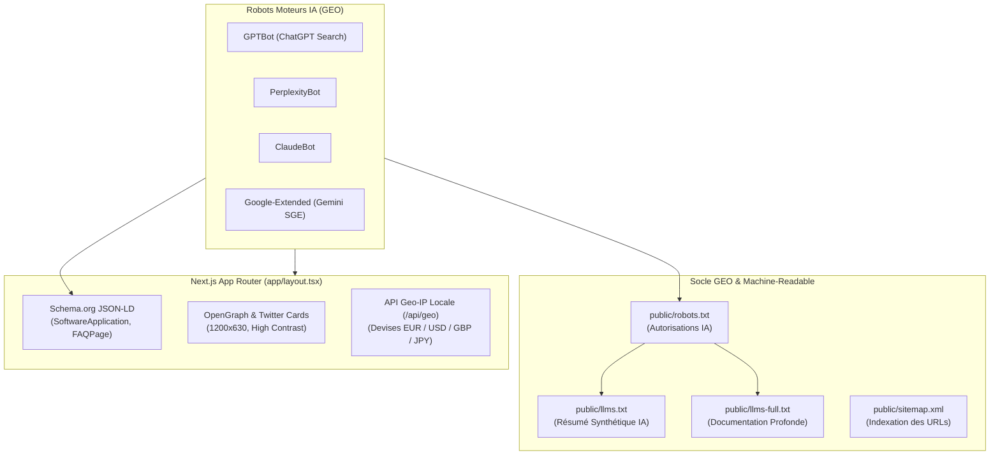

# Guide Stratégique SEO, GEO & LLMO — PromptShift (promptshift.dev)
*Inspiré des méthodologies d'ingénierie sémantique et de Generative Engine Optimization (ChatSEO.app, Perplexity, ChatGPT Search, Google SGE)*

---

## 1. Introduction : Du SEO Traditionnel au GEO (Generative Engine Optimization)

Pendant 20 ans, le référencement web (SEO) a consisté à positionner des pages sur les "liens bleus" de Google via des mots-clés et des backlinks.
Aujourd'hui, avec l'émergence de **ChatGPT Search**, **Perplexity AI**, **Claude 3.7**, **Cursor**, et **Google AI Overviews (SGE)**, les développeurs posent des questions directes à des agents d'intelligence artificielle :
> *"Comment convertir mes règles Cursor .cursorrules vers Claude Projects sans perdre mon contexte ?"*
> *"Existe-t-il un outil gratuit et sécurisé pour transférer un projet OpenAI Custom GPT vers Gemini ?"*

Si un site n'est optimisé que pour les anciens robots Google, **les moteurs d'IA ne le citeront jamais**. 
L'approche de PromptShift combine donc **3 piliers fondamentaux** :
1. **SEO Classique** : Vitesse, balises canoniques, sitemap XML, métadonnées OpenGraph et Twitter cards.
2. **GEO (Generative Engine Optimization) & LLMO** : Balisage Schema.org multi-entités, standard `llms.txt`, FAQ structurée orientée réponses conversationnelles directes.
3. **GEO-Localisation & Devises** : Détection géographique native par IP / Timezone (EUR, USD, GBP, CAD, AUD, JPY) sans cookie intrusif.

---

## 2. Reverse Engineering de la Méthodologie ChatSEO.app

En analysant la structure de [ChatSEO.app](https://chatseo.app/), plusieurs patterns d'excellence ont été identifiés et directement adaptés dans l'architecture de PromptShift :

| Méthodologie ChatSEO | Application Concrète dans PromptShift |
| :--- | :--- |
| **Balisage Schema.org Multi-Entités** | Intégration dans `app/layout.tsx` d'un tableau JSON-LD combinant `Organization`, `WebSite`, `SoftwareApplication` et `FAQPage`. |
| **Robots Directives pour Crawlers IA** | Autorisation explicite de `GPTBot`, `PerplexityBot`, `ClaudeBot` et `Google-Extended` dans `public/robots.txt`. |
| **Directives Googlebot Avancées** | `max-video-preview: -1`, `max-image-preview: large`, `max-snippet: -1` pour autoriser Google à extraire de grands extraits visuels. |
| **Alternates & Canonical** | Gestion stricte de `canonical` et des déclinaisons linguistiques (`en-US`, `fr-FR`, `x-default`) pour éviter tout contenu dupliqué. |
| **Transparence d'Offre Logicielle** | `SoftwareApplication` avec `AggregateOffer` (lowPrice: 0, highPrice: 19.99, priceCurrency: USD/EUR) reflétant la Bêta gratuite et le futur mode commercial. |

---

## 3. L'Architecture GEO & LLMO Déployée sur PromptShift

### 3.1 Le Standard `public/llms.txt`
Le fichier `llms.txt` agit comme un **plan de site textuel ultra-dense** pour les LLMs. Lorsque Perplexity ou ChatGPT explorent `promptshift.dev`, ils lisent directement ce fichier pour comprendre :
- La proposition de valeur : *1-click universal transpiler between Gemini, Claude, OpenAI & Cursor*.
- La matrice de conversion bidirectionnelle supportée.
- Les garanties de sécurité souveraine (traitement in-RAM, zéro stockage disque, désensibilisation regex de 15 formats de tokens API).
- Les conditions d'accès (Bêta publique gratuite, Free Starter instantané pour ≤ 5 fichiers, Pass Pro offert avec email).

### 3.2 La Documentation Profonde `public/llms-full.txt`
Permet aux modèles avancés (comme Claude 3.7 Sonnet ou ChatGPT Search en mode Deep Research) de citer précisément les spécifications techniques de PromptShift :
- Gestion des défenses Zip Slip et Zip Bomb.
- Prise en charge des globs `.cursor/rules/*.mdc`.
- Préservation de 98.5% de fidélité sémantique.

### 3.3 Balisage `FAQPage` pour l'Extraction de Réponses
Dans `app/layout.tsx`, 4 questions-réponses clés sont injectées sous forme de données structurées :
1. *What is PromptShift?*
2. *Is my source code and proprietary API keys secure?*
3. *How does the Free Public Beta work?*
4. *Which AI platforms are currently supported?*

Ces réponses fournissent un verbatim prêt à l'emploi que Google AI Overviews et Perplexity affichent directement en encart de synthèse.

---

## 4. Localisation Géographique & Devises (GEO-Localisation)

### 4.1 Fonctionnement Sans Cookie
PromptShift n'utilise aucun bandeau cookie intrusif. La géolocalisation fonctionne par couches logiques ultra-rapides :
1. **En-têtes Edge CDN** : `x-vercel-ip-country` (sur Vercel) ou `cf-ipcountry` (sur Cloudflare).
2. **Endpoint Dédié** : `/api/geo` analyse le pays et renvoie la devise associée (`EUR` pour la zone euro, `USD` pour les USA/Monde, `GBP` pour le Royaume-Uni, `CAD`, `AUD`, `JPY`).
3. **Fallback Client** : En environnement local ou hors en-tête CDN, le gestionnaire `CurrencyManager` analyse `Intl.DateTimeFormat().resolvedOptions().timeZone` et `navigator.languages`.
4. **Persistance Souveraine** : Le choix est stocké dans le `localStorage` du navigateur. Si l'utilisateur clique manuellement sur le sélecteur de devise de la barre de navigation, son choix explicite prévaut définitivement.

---

## 5. Comment Mesurer Votre Visibilité GEO en Pratique

Dès la mise en ligne sur `https://promptshift.dev` :
1. **Sur Perplexity AI** : Tapez *"best tools to convert cursor rules to claude projects"* ou *"how to migrate custom gpt to cursor"*. Vérifiez que PromptShift apparaît dans les sources citées en note de bas de page.
2. **Sur ChatGPT Search** : Demandez *"Can I convert a .cursorrules file to an Anthropic Claude project prompt automatically?"*.
3. **Sur Google Search Console** :
   - Ajoutez le domaine `promptshift.dev`.
   - Soumettez le sitemap `https://promptshift.dev/sitemap.xml`.
   - Vérifiez l'onglet "Données structurées" (Extraits enrichis / Rich Snippets) pour valider l'indexation de `SoftwareApplication` et `FAQPage`.
